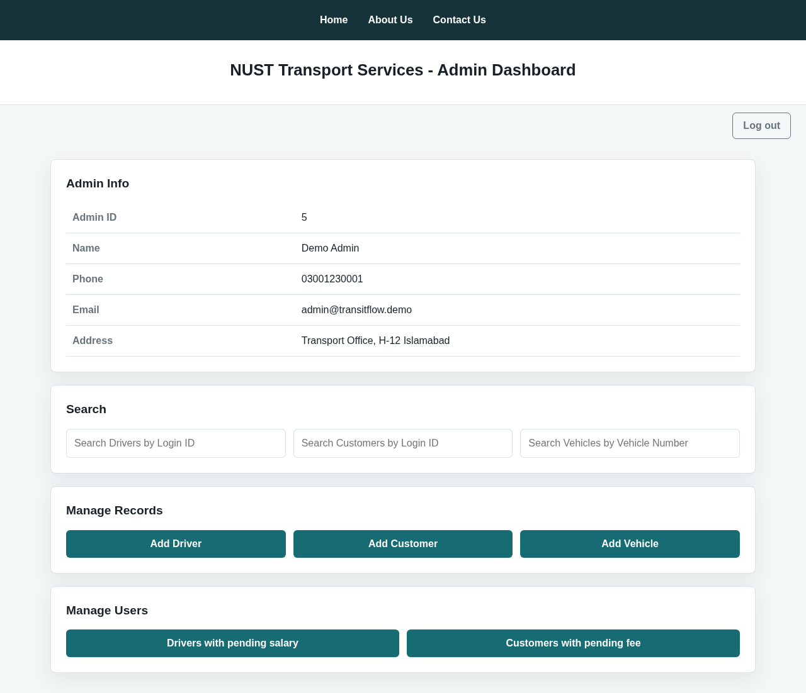
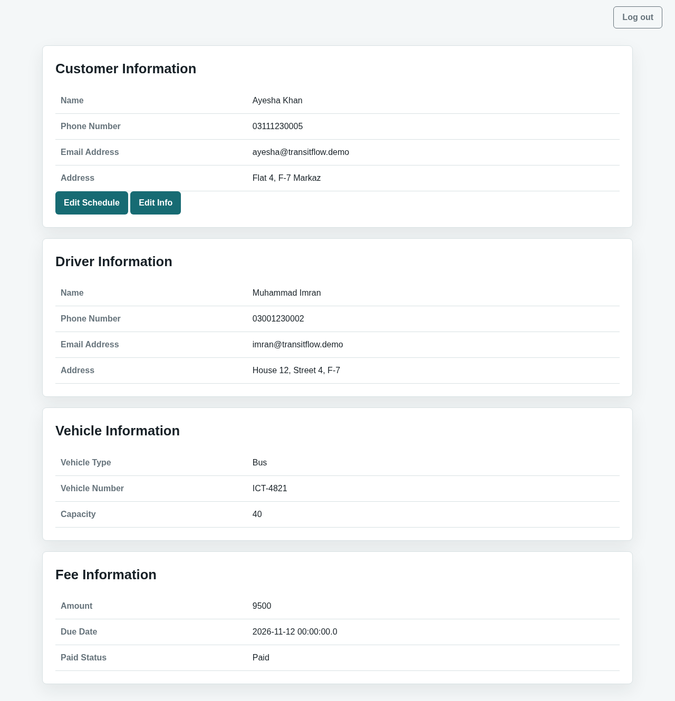
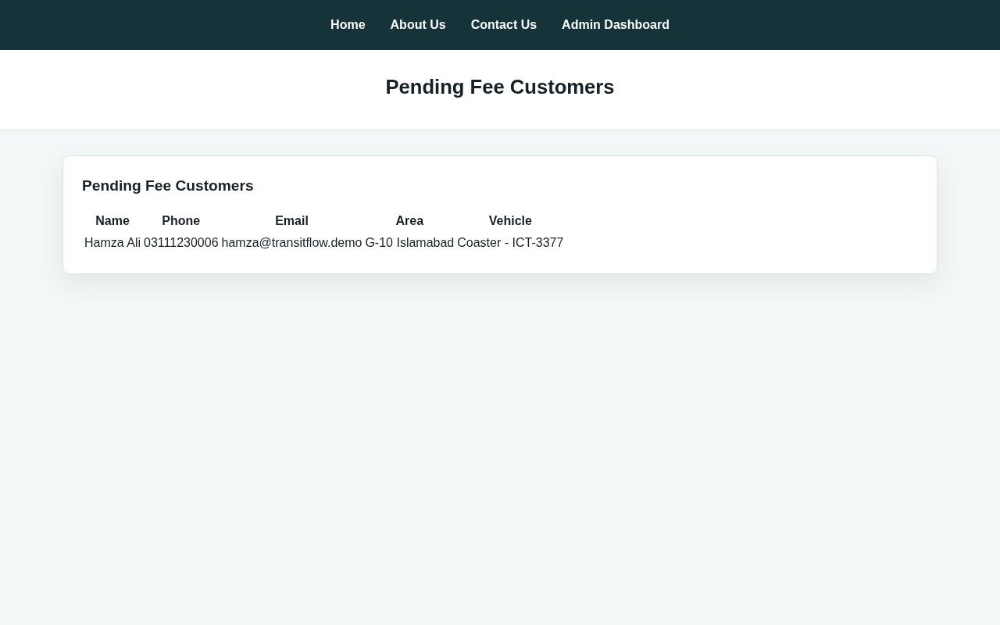

# TransitFlow

A web app for running a university transport service. Admins manage customers, drivers, vehicles, fees and salaries; drivers see their vehicle and details; customers see their driver, vehicle, fee and weekly pick-up schedule.

[](https://github.com/Abdul-Wahab-17/TransitFlow/actions/workflows/ci.yml)
[](LICENSE)



## Features

- **Three roles** (admin, driver, customer) with session login using a numeric login ID and PIN. PINs are stored as BCrypt hashes.
- **Admin:** add, edit and search customers, drivers and vehicles; list customers with a pending fee and drivers with a pending salary; reset a user's PIN.
- **Customer:** self-signup, see assigned driver, vehicle and fee, edit the weekly morning/evening schedule.
- **Driver:** self-signup, see vehicle details, edit contact details.
- **Optional super admin** (set through environment variables) who creates admin accounts.
- CSRF protection on every form, role checks on every route, and a log-out button on each dashboard.

| Customer | Pending fees |
|---|---|
|  |  |

## Quick start

```bash
docker compose up --build
```

Open **http://localhost:8080**. The `demo` profile (on by default in Docker) fills an empty database with sample areas, vehicles, drivers and customers, and prints the demo logins:

```bash
docker compose logs app | grep -A5 "demo accounts"
```

```text
Admin    login ID 4   PIN 1111
Driver   login IDs 6, 8, 10   PIN 2222
Customer login IDs 12, 15, 18  PIN 3333
```

The login IDs depend on the database, so use the ones in your own log. To start with an empty database instead, run `SPRING_PROFILES_ACTIVE=default docker compose up --build`.

## Run without Docker

You need JDK 17, Maven, and MySQL 8 with an empty `tms` database.

```bash
export DB_PASSWORD=<your password>          # DB_USERNAME defaults to root
mvn spring-boot:run -Dspring-boot.run.profiles=demo
```

## Configuration

All settings are environment variables; see `.env.example` and `src/main/resources/application.properties`.

| Variable | Default | Purpose |
|---|---|---|
| `DB_URL` | `jdbc:mysql://localhost:3306/tms` | JDBC URL |
| `DB_USERNAME`, `DB_PASSWORD` | `root`, empty | Database login |
| `DB_DDL_AUTO` | `update` | Hibernate schema management |
| `SPRING_PROFILES_ACTIVE` | none | `demo` seeds sample data into an empty database |
| `SUPERADMIN_LOGIN_ID`, `SUPERADMIN_PIN` | empty | Enables a super admin at `/superadmin`. Disabled unless both are set. |
| `PORT` | `8080` | HTTP port |

## Tests

```bash
mvn test
```

The tests use an in-memory H2 database, so no MySQL is needed. They cover PIN hashing and login, the super admin being disabled by default, admin search and access checks, CSRF protection, and application start-up.

## Architecture

Spring Boot 2.7 (Java 17) with Spring MVC and Thymeleaf templates, Spring Data JPA on MySQL, and Spring Security for CSRF and password hashing. Each domain (`Admin`, `Customer`, `Driver`, `Vehicle`, `Fee`, `Salary`, `Schedule`, `Area`, `Login`) has an entity, repository, service and controller under `src/main/java/packages/project`. `Security/AuthSession` holds the session role checks used by every controller.

## License

[MIT](LICENSE) © 2026 Abdul Wahab
